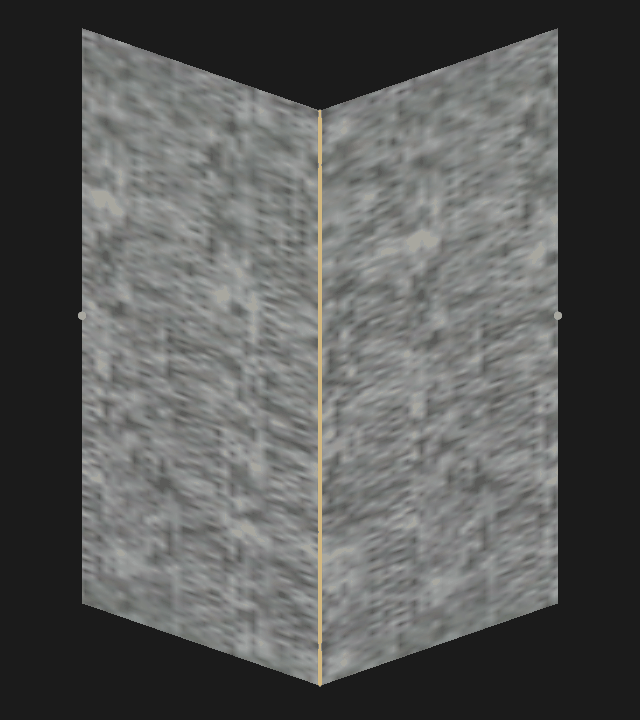
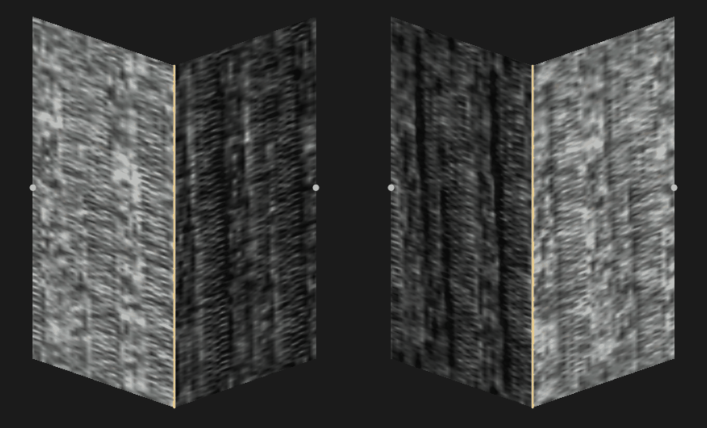

# fabric-stretch

A rig, Python pipeline and Rust viewer for measuring how fabric looks as it stretches.
The rig captures images and force readings; the pipeline builds registered textures, albedo
and normal maps; the viewer lets you stretch, press and relight the result.





## Try the demo

```sh
git clone https://github.com/personne-admin/fabric-stretch.git
cd fabric-stretch
cargo run --release -p fabric-viewer -- examples/demo
```

Open **View > Press View**, enable **Relight**, and drag the light pad.
The [demo](examples/demo/README.md) is a small extract of a real measurement.

To render a PNG without a window:

```sh
cargo run --release -p fabric-viewer --example press_snapshot -- examples/demo \
    --indentation 20 --relight --light-az 200 --light-el 35 --out press.png
```

## Process a measurement

Install with Python 3.10 or newer:

```sh
python -m venv .venv
. .venv/bin/activate
pip install -e .
```

Record with `fabsim rig`, [track the points](docs/self_hosting_tracker.md), then build:

```sh
fabsim validate <project>
fabsim ps <project>           # optional; writes per-run maps
fabsim package <project>
fabsim validate-package <project>
cargo run --release -p fabric-viewer -- <project>
```

To rebuild the demo, use its [smaller tiling settings](examples/demo/README.md#regenerate).

## Documentation

- [Pipeline](docs/pipeline.md) and [file formats](docs/formats.md)
- [Rig setup and calibration](docs/hardware.md)
- [Firmware](firmware/README.md) and [serial protocol](docs/serial_protocol.md)
- [Tracker setup](docs/self_hosting_tracker.md)
- [Photometric stereo](docs/photometric_stereo.md) and [texture tiling](docs/texture_tiling.md)
- [Viewer controls and rendering](docs/press_view.md)
- [Development setup](CONTRIBUTING.md), [open work](ROADMAP.md), [release history](CHANGELOG.md)

This is research software. Press View uses two planes, not a cloth simulation; the
[lighting model has limits](docs/photometric_stereo.md#limits) too.

## Licence

[Apache 2.0](LICENSE). Third-party terms are in [NOTICE](NOTICE), including CoWTracker's
non-commercial restriction.
