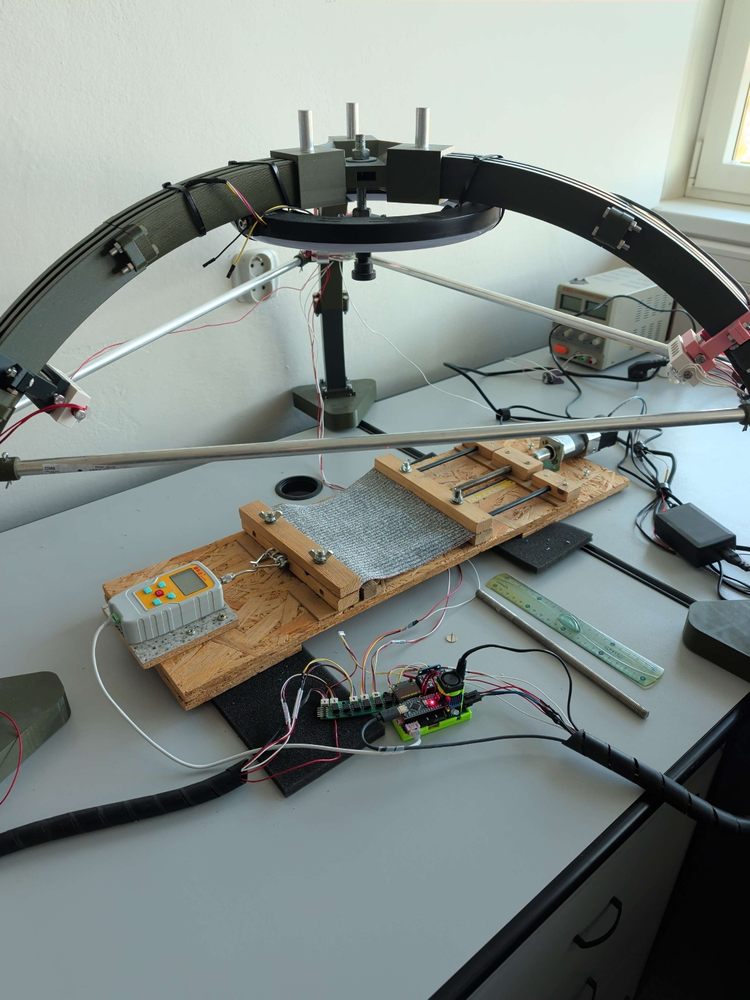

# The measuring rig

The motor stretches a fabric strip; the camera records it under each light, and the load cell
records tension. See [Serial protocol](serial_protocol.md) and [Firmware](../firmware/README.md).

Part numbers and wiring diagrams were not recorded. Details marked "inferred" need checking
against the rig.

## Photos



[Clamp detail](images/photo_measuring_rig_full.jpg) · [Acquisition app](images/rig_app.png)

## Parts

| Part | What it is | Source of the information |
| --- | --- | --- |
| Camera | IDS uEye industrial camera, software-triggered, 8-bit BGR, full sensor size, driven by the `pyueye` wheel and the vendor SDK | `src/fabsim/rig/hardware/camera.py` |
| Lights | 8 switchable LED outputs on four 1-Wire switches, one shared power setting (digital potentiometer). Three LEDs form the directional set used for photometric stereo; an optional second set of three has the second polarisation; one is a diffuse light | `firmware/motorV4/Light.hh`, `led_config.json` |
| Load cell | digital load cell with a clocked output, read by the firmware; calibration (zero and N per count) is stored in the controller's EEPROM | `firmware/motorV4/Tensiometer.hh` |
| Motor and clamp | stepper motor, 49:1 gearbox, 1.5 mm pitch lead screw; one clamp bar is fixed (load cell side), the other is moved by the screw | `src/fabsim/rig/mechanics.py`, photos |
| Controller | Arduino-class board (ATmega328P, inferred), firmware `motorV4`, USB serial | `firmware/` |
| Computer | runs the rig app; camera by USB, controller by USB serial | |

The camera model and lens are undocumented. `session.json` records the reported camera name and size.

### Camera

* uEye device 0, full sensor, software trigger, `BGR8_PACKED`; saved as RGB PNG.
* The driver may clamp exposure. Capture and calibration refuse a readback more than 2 %
  from the request.
* Exposures of 20 ms or more are reported as likely to clip.
* The `Simulated` checkbox next to *Open Camera* selects a synthetic test-pattern camera
  (320 x 240). Runs made with it are marked `simulated` in `session.json`.
* The firmware camera trigger output (command `#`) exists but is not used by the software
  trigger.

### Lights

Lamp assignments and geometry are stored in `led_config.json`:

| Key | Meaning | Packaged default |
| --- | --- | --- |
| `pol_a_bits` | output bits of the three directional LEDs of set A, in the order of `light_azimuths_deg` | `[1, 3, 5]` |
| `pol_b_bits` | output bits of the three LEDs of set B (second polarisation), or empty | `[2, 4, 6]` |
| `diffuse_mask` | bit mask of the diffuse light | `1` |
| `light_elevation_deg` | elevation of the directional LEDs above the image plane, degrees | `45.0` |
| `light_azimuths_deg` | azimuth of each LED of set A, degrees, counter-clockwise from image-right (image y up); azimuth `i` belongs to the LED on bit `pol_a_bits[i]` | `[91.27, 334.26, 211.16]` |

Defaults in `src/fabsim/rig/defaults/led_config.json` belong to the original rig. Calibrate yours
using the *Capture Mode* dialogs; each run stores a snapshot in `session.json`.

* **Identify LEDs** assigns outputs to Pol A1–A3, Pol B1–B3, diffuse or unused. Sets must
  contain all three LEDs or none. Reordering set A clears its azimuths; recalibrate before PS.
* **Calibrate Light Angles**: put an upright object in view, then click its base and shadow
  tip under each LED. Azimuth is opposite the shadow; enter elevation (10–85°) and save.

All outputs share one power setting.

**Capture modes.** *RGB*: one shot per state with `led_mask` (default preset mask 85 =
bits 0, 2, 4, 6). *Sequential white LEDs*: one shot per LED, in order: optional `diffuse`,
then `ps_1`..`ps_3` (set A), with *Polarization* also `ps_b_1`..`ps_b_3` (set B). The images are
named `img_NNNN_<role>.png` with roles `rgb`, `diffuse`, `ps_1..3`, `ps_b_1..3`.

### Load cell

The controller reports force and the underlying counts; [force.json](formats.md#forcejson)
defines the conversion. Calibration is stored in [EEPROM](../firmware/README.md#eeprom-layout).

Calibration steps:

1. Connect, unload the cloth, click **Tare** in the app (command `@`). The current reading becomes
   zero and is stored in EEPROM.
2. Set the coefficient once with the *Serial* box at the bottom right of the app: type
   `*<N per count>` (for example `*0.0125`) and *Send*. The firmware answers `coef: <value>`.
   Choose the value with a known weight: coefficient = known force in N divided by the change of
   `raw_counts` shown in the `TENSION` line. A blank EEPROM gives a meaningless coefficient until
   this is done; see [Blank EEPROM](../firmware/README.md#blank-eeprom).
3. Check with the **Tension** button, which prints one `TENSION force_n=...` line to the log.

The app records every reading in `force.json` (force, raw counts, zero, coefficient). The line
load in `frames.json` is `force / clamp width`; set the **Clamp width (m)** field to the real
clamp width (default 0.2 m).

**Safety limits.** *Max force (N)* arms the controller's [force-limit trip](serial_protocol.md#force-limit).
*Release steps* sets the return movement after a trip. The app also checks each reading and stops
the run. *Max stretch (mm)* stops the run before the travel limit is exceeded; `0` disables a limit.
Stop sends the controller's [stop command](serial_protocol.md#stopping). If it is not
acknowledged, check the controller and use the physical panic button. Older firmware needs reflashing.

### Motor and clamp

* The firmware counts *command steps*. `+N` stretches, `-N` releases.
* Travel per command step: 1500 um / (200 x 49) = **0.153 um**, which assumes the stepper driver
  is set to 1/16 microstepping: the firmware emits 16 driver pulses per command step, matching
  the effective `microsteps=1` in `MotorMechanics`. Check the driver switches; another setting
  requires adjusting the mechanics or recorded travel will be wrong.
* The recorded travel includes the firmware's [extra motor period](../firmware/README.md#extra-motor-period).
* The **Speed** button switches the multiplier. See [Move timing](serial_protocol.md#move-timing)
  for durations and completion behaviour.
* Two panic buttons on the board (pins 2 and 3) stop a move; with no move running they jog
  +400 or -400 steps.
* Bring the clamp to the starting position with the **Left** and **Right** jog buttons
  (*Jog steps*, default 200) before a run. Direction names in the app (`warp`, `weft`, `bias`)
  only say how the sample was cut and clamped; motion is `Loading` or `Release`.

## The acquisition app

Install and start (from the repository root, with the venv active):

```bash
pip install -e ".[rig]"       # pyserial; the app also needs tkinter (system package)
python -m fabsim.rig          # same as: fabsim rig
python -m fabsim.rig --paths  # print the config and log directories
python -m fabsim.rig --init-config   # copy the packaged defaults to the config directory
```

Other options: `--init-config --force` overwrites existing files, `-v` logs DEBUG to the console.
The camera additionally needs the IDS uEye SDK driver and `pip install pyueye`. Without them
the app runs with the simulated camera.

Typical session:

1. Select the serial port (*Refresh*, *Connect*; allow the board to reset) or the port
   `SIMULATED`. *Open Camera*, or tick *Simulated* first.
2. *Set Project Folder*. Runs are saved as
   `<project>/<sample_id>/<direction>_<motion>[_N]/`. Rename the run you want to analyse if it has a `_N` suffix; see
   [run naming rules](formats.md#project-and-run-files).
3. Set capture count, step size, lighting, exposure, sample details and limits. Choose a capture mode.
4. Check the camera, lights and tension reading before starting.
5. *Run Measurement*. The first state is captured at rest. Each later state moves, settles,
   captures and reads force. Files are saved after each frame, including on an aborted run.

*Relaxation capture* additionally pauses after chosen states (*Select Relax Points*, duration in
ms) and captures a second set marked as a relaxation hold.

The **Photometric Stereo** tab and the commands `fabsim stereo` and `fabsim ps-verify` process the
sequential captures of a run.

### Colour calibration

*Calibrate Colors* fits diffuse and point-light models from a 6 × 5 colour chart, saved as
`color_calibration.json`. Capture exposure must match within the [camera tolerance](#camera).
A loaded bundle corrects saved images; *Keep uncalibrated (raw) images* also saves originals in
`images_raw/`. Without a bundle, images stay raw.

The bundle copied by `--init-config` belongs to the original camera and lights. Fit a new one
for a different setup.

### Presets and settings

Per-user files live in the platform config directory: `$XDG_CONFIG_HOME/fabsim-rig` or
`~/.config/fabsim-rig` on Linux, `%APPDATA%\fabsim-rig` on Windows, `~/Library/Application
Support/fabsim-rig` on macOS. Set `FABSIM_RIG_CONFIG_DIR` to use another directory. Logs
(`rig.log`, rotating, 1 MB x 3) go to `%LOCALAPPDATA%\fabsim-rig\Logs`,
`~/Library/Logs/fabsim-rig` or `$XDG_STATE_HOME/fabsim-rig` (`~/.local/state/fabsim-rig`);
`FABSIM_RIG_LOG_DIR` overrides it. Nothing depends on the working directory.

| File | Content |
| --- | --- |
| `presets.json` | list of measurement presets; written by *Save* in the *Presets* box |
| `led_config.json` | LED bit mapping and light geometry (see above) |
| `color_calibration.json` | colour calibration bundle |
| `state.json` | remembered paths (project folder, last colour bundle) |

Missing presets and LED config use packaged defaults in memory; unreadable files are errors.
Saving or `--init-config` creates the files. Colour calibration has no fallback.

A preset is a JSON object with `name`, `count`, `step_size` (command steps per increment,
no sign), `led_mask`, `led_power`, `settle_ms`, `cam_exposure_ms`, `speed_mult`,
`relax_enabled`, `relax_indices`, `relax_duration_ms`, and optionally `motion_mode`,
`capture_mode`, `polarization`, `include_diffuse`, `release_steps`. Older presets with a signed
`step_size` still load (a negative value means release). Packaged presets: `Static 1-shot`,
`procedure01_36images` (36 x 20000 steps, about 3.06 mm per step), `dense_80_step10k`,
`procedure03_72images`. A preset that leaves out the capture setup keeps the current choice.

## Developing without hardware

* Port `SIMULATED` in the port list plus *Simulated* camera: the whole app runs. The simulated
  controller (`src/fabsim/rig/hardware/fake.py`) completes moves at once; the force grows
  linearly with position (0.0005 N per step). The force limit trip is simulated, the firmware's
  auto-release is not.
* The tests use the same simulator: `pytest tests/python/test_rig_*.py` (needs `pip install -e ".[dev]"`).
* Set `FABSIM_RIG_CONFIG_DIR` and `FABSIM_RIG_LOG_DIR` to temporary directories to keep your real
  config separate from your usual setup.

## Windows build

[Releases](releases.md) include native Windows builds of the viewer, CLI and rig app.
CI builds and tests these on Windows. The Wine helper below is an alternative for local builds.

`scripts/build_windows.sh` builds a single `dist/fabsim-rig.exe` from Linux with Wine, a Windows
Python and PyInstaller. Usage: `scripts/build_windows.sh [--run]`; `--run` starts the exe under Wine
afterwards.

One-time setup of the Wine Python (default `C:\Python312\python.exe`, override with `PY_WIN`):

```bash
wine C:\\Python312\\python.exe -m pip install pyinstaller pyserial pillow numpy opencv-python-headless
wine C:\\Python312\\python.exe -m pip install pyueye     # needs the IDS uEye SDK driver at run time
```

The build checks dependencies and bundles defaults; torch is excluded. Without `pyueye`,
only the simulated camera is available. Config and logs use the per-user folders above.
Build log: `build/winbuild/pyinstaller.log`.

## Firmware

See [firmware build instructions and known issues](../firmware/README.md). Pin assignments are
in [`Constants.hh`](../firmware/motorV4/Constants.hh). Check the driver microstepping and the
load-cell coefficient before the first run on a new board.
