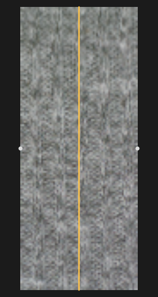

# Press View

Press a bar into the measured fabric, scrub through its stretch states, or relight it.
Build a package with [the pipeline](pipeline.md) first, or open `examples/demo`.

## Getting started

```sh
cargo run --release -p fabric-viewer -- <project>
```

Choose **View > Press View** or **+ View**. Each view has its own controls, so you can compare
branches or lighting side by side. You can open one project or a folder containing several.

## Controls

| Control | Use |
| --- | --- |
| Project / Package / Orientation | select the measurement; Package appears only when several generations exist |
| Loading / Release | select the branch |
| Tiled / Untiled | repeat the tile, or draw the registered atlas once |
| Relight | shade the albedo and normals; requires photometric layers |
| Oblique / Top | 30-degree oblique view or plan view |
| Reset | reset controls and rescan packages |
| + View | add a view |

Disabled controls explain why on hover. Load failures appear in yellow; **Rescan** retries them.

Choose **Force** to drive the slider by strip tension in N, or **Indentation** for bar depth as a
percentage of clamp span. Force is the load-cell reading, not the bar's force. An unreliable
force fit defaults to Indentation; see [Force and indentation](#force-and-indentation).

Drag the orange bar along the sheet (5–95 % of the span). Drag the light pad around for azimuth
or towards the centre for higher elevation. The pad uses screen coordinates, counter-clockwise
from screen right.

Light defaults: azimuth 135°, elevation 45°, intensity 1, ambient 0.1. Intensity ranges from 0–4,
ambient from 0–1.

The status line shows stretch `λ`, tension `F`, bar depth and position, and the two source frame
IDs with their blend weight `t`. `(fit)` means the force came from the fit; `F n/a` means no fit.
Stretches outside the data range use the nearest state and are marked clamped.

## Package set discovery

The viewer searches the project folder in this order:

| Set | Tiled | Untiled |
| --- | --- | --- |
| `v3` | `material_package_v3/` | `material_package_v3_untiled/` |
| `legacy v2` | `material_package/` | `material_package_untiled/` |

Each orientation is a subfolder with a usable `package.json`; `warp` and `weft` appear first,
then the rest alphabetically. `tiling.enabled` determines the variant, regardless of folder name.
The first usable set is selected. Missing variants are disabled; invalid packages are listed
as skipped. See [format checks](formats.md#what-the-viewer-requires) and
[v2 compatibility](formats.md#version-2-packages-and-how-the-viewer-treats-them).

Discovery and package loading run in the background. The view shows image-check progress;
**Cancel loading** stops the request, and **Rescan** retries it. Reset/Rescan also clears cached
errors. Changed manifests and textures reload when their modification times change.

## Internals

### Sheet geometry

The clamps are at `s = 0` and `s = 1`. Bar position `beta` (default 0.5) and depth `delta` are
fractions of that span. Two planes join the clamps to the bar:

```
lambda = hypot(beta, delta) + hypot(1 - beta, delta)
v_bar = hypot(beta, delta) / lambda
```

`v_bar` is the material coordinate at the bar, keeping the texture continuous across it.

### Mapping the atlas onto the sheet

For `active_grid_axis: vertical`, pull = atlas row `v` and across = `1 - u`. This rotates the
image 90° counter-clockwise, preserving handedness. For `horizontal`, pull = column and
across = row, with no rotation.

Sheet aspect comes from the source atlas, including for tiled packages. For a vertical pull it
is `width / height`. Tiled lookup uses `(material_uv - origin_uv) / period_uv`, wrapped per
fragment; untiled lookup clamps to the atlas edges.

`Projection` handles drawing and bar dragging. Pull is screen x, across is screen y in plan
view, and the oblique view tilts by 30°.

### Force and indentation

Indentation sets `delta`, capped at the depth that reaches the branch's highest measured stretch.

Force uses a monotone piecewise-linear `ForceFit` (pool-adjacent-violators) of tared tension
against stretch. Inverting it gives stretch; bisection gives the corresponding depth at `beta`.
Flat parts keep the previous stretch. The slider runs from `force_at(1.0)` to the highest fitted
force; negative tared readings are allowed.

A fit needs at least two states with distinct stretches. It is flagged unreliable if:

- tension range is below 1 N;
- range is below three times the fit's RMS residual;
- fewer than four distinct tension levels remain.

An unreliable fit starts in Indentation mode; Force can still be selected. With no fit, Force
is disabled. Switching modes keeps the current state. Defaults are 40 % of the force range
or 12 % indentation.

This check is separate from the packager's [force quality](formats.md#force), which the viewer
does not read.

### Choosing the textures

`texture_plan` brackets the requested stretch with two measured states and a blend weight.
Outside the measured range it uses the nearest state. Loading starts at 1; release starts at
the measured residual stretch.

### Relight light pad in screen space

Normals use the data frame; the light pad uses the screen frame. For a vertical pull:

```
data_to_screen(x, y) = (-y, x)
screen_to_data(x, y) = (y, -x)
```

A capture LED at data azimuth `a` therefore needs screen azimuth `a + 90°`. Horizontal pulls
need no rotation.

The cloth planes tilt by `atan2(delta, beta)` and `-atan2(delta, 1 - beta)`. The renderer applies
the inverse tilt to each plane's light, then converts it to the data frame. It mixes albedo and
normals between states, renormalises, and applies the [relight model](photometric_stereo.md#the-relight-model).

### GPU path

`press_gpu.rs` draws two textured quads in egui's wgpu pass. The fragment shader samples and
mixes both states; changing the bar, light or blend weight needs no texture upload.

- Colour textures use `Rgba8UnormSrgb` for linear-light interpolation.
- Albedo/normals use `Rgba16Unorm`, falling back to `Rgba8Unorm` without
  `TEXTURE_FORMAT_16BIT_NORM` support.
- Textures have mipmaps and trilinear filtering. Tiles repeat; atlases clamp to edges.
- Oversized textures are refused. Rebuild smaller ones or set `FABRIC_CPU_RENDER=1`.

Each draw currently allocates vertex/uniform buffers and a bind group.

### CPU fallback

Without wgpu, or with `FABRIC_CPU_RENDER` set to any value (including `0`), `press_render.rs`
renders on a worker thread. It uses the same sampling and shading as the GPU; tests compare
them within about 0.1/255. Only the newest job is rendered, capped at 1600 pixels on the long
side. Worker panics appear as errors. This renderer also drives CPU snapshots.

### Texture streaming and cache

Views share a `PackageStore` for packages, discovery, errors and GPU textures.
Two workers decode images and build mipmaps, with at most two uploads per frame. Adjacent
states are prefetched. While a new pair loads, the last complete pair remains visible.

The GPU cache targets 512 MiB but keeps textures in use. File times are checked at most once
per second. Failed decodes retry on file changes or Rescan; vanished files keep their last
good texture.

A separate worker discovers and loads packages; PNG header checks use up to eight threads.
Closing a project or rescanning cancels its old requests and discards late results.

### Headless snapshots: `press_snapshot`

Render a PNG without a window (CPU by default):

```sh
cargo run --release -p fabric-viewer --example press_snapshot -- <project> [options]
```

| Option | Default | Meaning |
| --- | --- | --- |
| `--out FILE` | `press_snapshot.png` | output PNG |
| `--size WxH` | `1200x700` | image size (16 to 8192 per side) |
| `--set v3\|v2` | newest set | package set |
| `--orientation NAME` | first discovered | e.g. `warp` |
| `--branch loading\|release` | `loading` | |
| `--force N` | | drive by the strip tension in newtons (needs a force fit; an error otherwise) |
| `--indentation PCT` | `12` | drive by indentation, percent of the span. Last of `--force` / `--indentation` wins |
| `--bar FRACTION` | `0.5` | bar position (limited to 0.05 to 0.95) |
| `--texture tiled\|untiled` | `tiled` | falls back to the variant the package has |
| `--relight` | off | shade the photometric layers |
| `--light-az DEG` | `135` | azimuth on the screen pad, counter-clockwise from screen right |
| `--light-el DEG` | `45` | elevation, 90 = straight on |
| `--intensity X` | `1` | |
| `--ambient X` | `0.1` | |
| `--view oblique\|top` | `oblique` | |
| `--gpu` | off | render with the GPU shaders on an offscreen target; error if no adapter |
| `-h`, `--help` | | usage |

Note that `--force` here is a tension in newtons, unlike `--force` of `fabsim package`.

The command prints the state and output path.

To regenerate the documentation images:

```sh
S="cargo run --release -p fabric-viewer --example press_snapshot -- examples/demo"
$S --indentation 20 --size 640x720 --out docs/images/press_oblique_tiled.png
$S --indentation 20 --view top --size 320x600 --out docs/images/press_top.png
$S --indentation 20 --relight --light-az 20 --light-el 35 --size 446x540 --out /tmp/left.png
$S --indentation 20 --relight --light-az 200 --light-el 35 --size 446x540 --out /tmp/right.png
python -c "import cv2, numpy as np; cv2.imwrite('docs/images/press_relight_pair.png', np.hstack([cv2.imread('/tmp/left.png'), cv2.imread('/tmp/right.png')]))"
```

These settings approximate the committed images; renderer changes may alter the pixels.



For the GPU path on a machine without a GPU, use SwiftShader:
`VK_ICD_FILENAMES=/usr/lib/chromium/vk_swiftshader_icd.json cargo run ... -- <project> --gpu`
(the path of the ICD file depends on the installation).

### Persisted state

View settings are saved in the dock layout and `.fvproj` files (**Project > Save Viewer Project**).
Enable "Restore dock layout on launch" to restore them at startup. `PersistedPressView` fields:

| Field | Meaning |
| --- | --- |
| `project` | source path of the project, matched against the open projects on restore |
| `package_set` | `v3`, `v2`, or none (newest) |
| `orientation`, `branch` | |
| `tiling` | Tiled requested |
| `relight`, `light` | toggle and the light (azimuth, elevation, intensity, ambient) |
| `top_view` | plan view |
| `control` | `Force`, `Indentation`, or none (automatic: Force when the fit is reliable) |
| `force_n` | tension in N (not clamped to zero) |
| `indentation`, `beta` | fractions of the clamp span |

Packages and textures are reloaded from the project. Older settings are converted: `manual_indentation: true` selects the Indentation control, and `position_mm` /
`depth_mm` (once measured in a fictitious 200 mm span) become fractions of the span. A `.fvproj` of
format version 2 or lower with a single `press_view` becomes one view.
